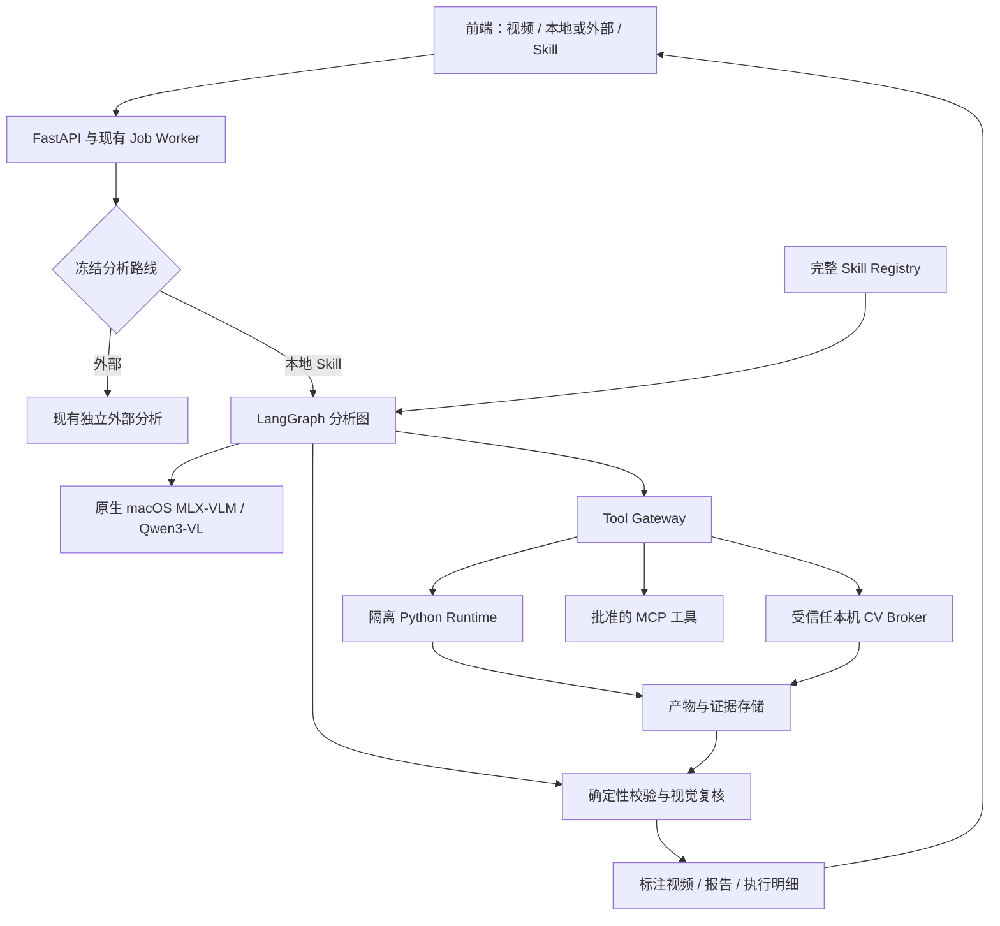

# Tennis Lab：Qwen3-VL + 可执行 Skill 本地分析引擎改造方案

日期：2026-09-18；修订版：v1.1（基于代码与原始脚本复核）  
状态：技术设计与开发交接；本文件不代表功能已经实现或部署。  
目标机器：MacBook Air M2 / 16 GB。  
适用项目：`/Users/bytedance/Documents/ChatGPT/tennis_video_analysis`。

## 本轮修订重点与阅读顺序

本轮只更新设计文档，未安装模型、执行上传脚本或改动业务代码。原包源码通过 ZIP 只读检查。

优先阅读：第 18 节（原方案缺口与修正）、第 19 节（Skill 到可执行计划）、第 20 节（默认包输入生成与时间适配）、第 21 节（作业、恢复和 API）、第 22 节（运行时落地）、第 23 节（验收与交付拆分）。第 1–17 节保留总体设计，相关要求已同步收敛。

本轮固定的关键决策：

- 首版仍限制 60 秒视频，固定机位先交付；不把长视频和任意多人物当作现成能力。
- `Qwen + 原包脚本` 之间增加可验证的计划编译与输入构建层，补齐原本由人准备的 JSON。
- 区分“支持加载所有文件”“CLI 可启动”“某种视频可完成分析”，避免三者混为一谈。
- VFR 先明确处理策略，不让旧脚本的平均 fps 计算冒充真实时间测量。
- 继续使用现有 `jobs.type=expert` 承载调度；新增 agent run 独立记录图状态，避免复用旧 `runs` 语义。
- SQLite 记录提交事实，LangGraph 检查点记录继续执行位置，崩溃恢复通过 reconciliation 对齐。

## 1. 结论与交付目标

将当前固定的本地分析管线，改造成 **Qwen3-VL 理解任务与检查证据、Skill 定义分析方法、Python 工具执行计算、LangGraph 管理任务状态、隔离运行时执行上传代码、MCP 连接受控能力** 的本地分析引擎。

第一版推荐组合：

| 层 | 选择 | 责任 |
|---|---|---|
| 本地视觉语言模型 | Qwen3-VL-4B-Instruct，MLX 4-bit 版本 | 场景判断、读取 Skill、选工具、解释与复核结果 |
| 模型推理服务 | macOS 原生 MLX-VLM 独立进程 | 图片/文本推理、资源释放、能力探测 |
| 流程编排 | LangGraph | 阶段依赖、检查点、取消、重试与质量门槛 |
| Skill Agent | 第一版受约束的工具决策节点；Deep Agents 作为后续可替换的有限子图 | 按需读取文档、计划步骤、必要时调整参数 |
| 脚本执行 | Linux ARM64 隔离容器 + 受控 Tool Runtime | 真正执行上传包内 Python，收集产物与日志 |
| 本机加速工具 | 单独的受信任 CV Broker | 对审核并固定版本的视觉工具提供 MPS 加速 |
| 扩展协议 | MCP，经统一 Tool Gateway 接入 | 工具发现、参数校验、资源读取、受控调用 |
| 展示 | 现有前端与导出链路 | 人物/球轨迹、分析报告、执行来源、局部调试 |

**不是让 Qwen 为视频的每一帧猜球坐标。** 连续追踪、姿态计算、运动学计算、绘图和编码由脚本执行；Qwen 看少量关键帧和脚本产生的证据，决定下一步。这样既能运行完整 Skill，也更符合 M2 16 GB 的资源条件。

本地模式不要求叠加外部模型。外部模式继续独立存在；选择本地后，不自动发送视频到外部服务，也不在失败时暗中切换外部模型。

交付必须包含：

1. 上传 `.zip` 后完整保留 `SKILL.md + scripts + references + assets`，执行记录可证明脚本确实运行。
2. 默认全自动完成分析，输出标注 MP4、结构化结果、中文报告和可查看的执行证据。
3. 能取消、恢复失败阶段、复用有效产物；资源不足时可明确降级。首版继承现有 60 秒上限，超过限制在入队前拒绝。
4. 主界面维持“选视频 → 选本地/外部 → 开始分析”，工程选项藏在设置和运行详情。
5. 对无法可靠测量的球速、落点或动作类型，展示“无法确定”和原因，不能用流畅报告掩盖证据缺失。

## 2. 依据与当前实现差距

### 2.1 当前代码已确认的事实

| 现有位置 | 当前行为 | 改造方向 |
|---|---|---|
| `backend/app/services/expert.py` | 固定组织本地视频、姿态、球、渲染流程；已有子进程取消和心跳机制 | 保留旧引擎用于回归，新增 Skill Agent 路由 |
| `backend/app/services/analysis_mode.py` | 固定 `local` / `external`，外部路线冻结连接和 Skill 信息 | 本地也冻结模型、Skill、运行时版本 |
| `backend/app/model_connections/skills.py` | `.md` / `.zip`，主要提取 Markdown；脚本不执行 | 迁移到独立的完整包注册中心，保留旧接口适配 |
| `backend/app/skill_runtime/manifest.py` | 已有固定版本的 Skill 包安装逻辑 | 统一到新导入器；不能直接当作通用执行器 |
| `backend/app/skill_runtime/contracts.py` | 已有严格证据帧和模型回答契约 | 复用坐标、帧号、证据约束，扩展为工具及产物契约 |
| `backend/app/services/external_analysis.py` | 抽帧、外部视觉请求、JSON 校验及渲染 | 保留为独立路线；不能用来代替可执行 Skill 引擎 |
| `backend/app/model_providers/base.py` | 偏向图片复核接口 | 新增 Agent 推理接口，不强塞进 `review_images` |
| `backend/app/model_providers/mcp_client.py`、`glm_coding_mcp.py` | 现有 GLM 相关 MCP 接入 | 与通用本地工具网关区分，避免名称相同就认为能力齐全 |
| `backend/app/worker/main.py` | SQLite 作业、心跳、取消、异常收尾 | 继续作为入口，LangGraph 负责单次分析内部流程 |
| `frontend/src/AnalysisChoice.tsx`、`SkillChoice.tsx`、`ModelConnectionDialog.tsx` | 分析路线、Skill 与模型连接交互 | 本地也支持 Skill；保留简洁主流程 |
| `frontend/src/App.tsx` | 结果选择需注意最近成功任务与当前所选路线不一致的问题 | 显式绑定 run，失败后不可将旧结果当成本次结果 |

已有名为 `test_skill_runner.py` 的测试不能作为“支持脚本执行”的验收依据：现有内容主要验证包安装边界，并不证明隔离执行、依赖、恢复和产物链路已经成立。

### 2.2 本次默认 Skill 来源

使用用户提供的 `/Users/bytedance/Downloads/user_skills (1).zip`。

- 包根目录：`sports-video-motion-analysis/`。
- ZIP SHA-256：`1d55f6f304b59bb728f78b23d704775a6822dce6760eb1f2d0aa1a93f8fcfee0`。
- 包含 15 个 Python 文件、8 个 references 文档，以及主文档和配置资产。
- 既有固定机位处理，也有转播视角、稳定化、标定、飞行拟合、落点图和报告要求。

过去的“文档规范模式”没有运行这些程序，无法复现完整工作流。新实现必须保留原包，另存项目适配层；不能再次用一段精简提示词替代整个 Skill。

### 2.3 已知能力与待验证能力分开

Qwen 官方模型卡描述了图像、视频及空间/时间理解能力，但这不等于它在本项目小球追踪上的精度已经达标，也不代表所有能力在 MLX 后端完全一致。[Qwen3-VL 官方模型卡](https://huggingface.co/Qwen/Qwen3-VL-4B-Instruct)

MLX-VLM 提供面向 Mac 的视觉语言模型推理接口。工程应固定版本并做实际能力探测，不能以兼容 OpenAI 风格接口为由，默认其工具调用、JSON 输出、多图与视频时间戳均满足要求。[MLX-VLM 项目](https://github.com/Blaizzy/mlx-vlm)

当前可作为验证起点的权重是 `mlx-community/Qwen3-VL-4B-Instruct-4bit`。这是社区转换版本，开发阶段要核验 revision、许可证、转换配置和样例输出，并固定到具体 revision。[MLX 社区权重](https://huggingface.co/mlx-community/Qwen3-VL-4B-Instruct-4bit)

**本方案未给出已实测的 M2 速度或精度结论。所有资源值、重试次数和质量目标均为设计起点，P0 实测后冻结。**

## 3. 系统边界与架构



### 3.1 LangGraph 与 Deep Agents 如何选择

使用 LangGraph 作为唯一的外层任务状态机。其持久化能力用于按运行保存检查点和恢复状态；但工具副作用是否安全重放，仍需要本项目实现幂等账本。[LangGraph Persistence](https://docs.langchain.com/oss/python/langgraph/persistence)

第一版不同时引入两个可自由循环的 Agent：

- LangGraph 控制阶段、预算、停止条件、恢复和最终状态。
- Qwen 决策节点只能从当阶段允许的工具集合中选择。
- Skill 的文件读取采用逐步加载：先元信息，再读主文档，再按需读 references 和脚本。
- Deep Agents 可作为 `plan_or_revise` 内部的有限子图，先以特性开关关闭；具备同等测试结果后启用。
- 子图不另建与父图冲突的恢复系统；父图负责 run 身份、外部工具账本及产物提交。

Deep Agents 的 Skills 机制支持按需读取文件，但“能读取 Skill”与“具备执行环境”是不同能力；其 backend/sandbox 接口仍需要接入真正的隔离运行时。[Deep Agents Skills](https://docs.langchain.com/oss/python/deepagents/skills)、[Backends](https://docs.langchain.com/oss/python/deepagents/backends)

这样能先解决项目的关键缺口：**完整包、真实执行、可复现的视频分析**，再评估复杂 Agent 框架是否带来额外收益。

### 3.2 模型与计算工具分工

| 工作 | 模型 | 脚本/确定性规则 |
|---|---|---|
| 判断固定机位、转播镜头、多人物 | 初判与抽样复核 | 镜头切换、全局运动、遮罩等统计验证 |
| 选择分析分支与参数 | 根据 Skill 和证据建议 | 限制参数范围与必需依赖 |
| 人物姿态与球轨迹 | 解释候选、处理少量歧义 | 逐帧检测、关联、轨迹提取 |
| 击球时刻/归属 | 看关键帧复核 | 音频、挥拍、球方向变化形成候选 |
| 球速和落点 | 解释可观测性与异常 | 标定、时间戳、物理拟合、残差检查 |
| 标注视频 | 看抽样结果判断明显错位 | 坐标变换、轨迹绘制、编码与音频 |
| 报告 | 写自然语言解释 | 指标、证据引用、单位和结论边界校验 |

Qwen 不直接凭单张图片填充绝对球速、不把自评 confidence 当成准确率，也不覆盖脚本的原始观测点。

## 4. M2 16 GB 部署与资源安排

### 4.1 部署形态

三个相互独立的运行环境：

1. **应用进程**：现有 FastAPI、worker、LangGraph、产物注册与前端。
2. **原生模型进程**：单独虚拟环境运行 MLX-VLM，监听 loopback，带短期调用凭证；负责模型加载、推理、卸载。
3. **隔离脚本环境**：Linux ARM64 容器执行用户包内程序；必要的 MPS 工具由独立且接口收窄的原生 Broker 执行。

普通 Mac Linux 容器不能按“容器内直接使用 macOS Metal/MPS”的方式部署 MLX。Docker Desktop 的常规 GPU 支持文档针对 Windows WSL2；本方案因此把 MLX 放在 macOS 原生进程，容器承担 CPU 脚本隔离。[Docker Desktop GPU 文档](https://docs.docker.com/desktop/features/gpu/)

不要将上述结论扩大为所有 Docker 产品都不可能调用宿主机模型服务；本方案明确采用宿主机推理服务与容器工具分离。

### 4.2 初始资源策略

| 项目 | 第一版设计值 | 说明 |
|---|---|---|
| 默认模型 | 4B Instruct / 4-bit | 不选 Thinking 版作默认流程控制器 |
| 轻量模型 | 经验证的 2B 量化配置，可选 | 资源不足时提示切换，记录真实模型，不静默替换 |
| 8B | 不作为 16 GB 默认项 | 是否开放由实测决定 |
| 重任务并发 | 1 | 整个应用共享资源租约 |
| 模型输入 | 常规 1–2 张图，验证后上限 4 张 | 疑难片段使用裁剪，而非一味增大整帧 |
| 上下文 | 先按 4K–8K 文本预算验证，视觉 token 单独计入 | 不按模型宣传的最大上下文运行 |
| 图片预算 | 初始长边 448/672；细节采用 ROI | 实际预处理后 token 数和误差必须记录 |
| Python 容器 | 初始 2 CPU / 2–4 GB，单任务 | 与模型加载阶段错峰，按任务配置硬限制 |
| 模型调用次数 | 初始上限 30 次/≤60 秒任务 | 包含格式修复与视觉复核；超限确定性收尾 |
| Agent 参数修订 | 同阶段最多 2 次 | 超过预算转降级或明确失败 |

4B 的 4-bit 纯参数存储理论量级约 2 GB，**不是整个模型进程的内存**。视觉编码器、量化元数据、KV cache、图像 token、推理临时张量还会增加占用。

估算模型阶段可能需要约 5–8 GB，应用约 0.5–1.5 GB，系统与其他应用还需数 GB；这些只是规划预算。容器 VM 和 PyTorch 工具同时常驻可能挤爆 16 GB，因此实施以下资源租约：

- 推理阶段申请 `metal_model` 租约。
- 原生姿态工具申请 `metal_cv` 租约，与前者互斥。
- 重 CV 阶段必要时结束模型进程，确认资源回收后再运行；仅删除 Python 变量不作为释放成功证据。
- CPU 后处理与推理是否可并行，由整机实测决定，第一版默认串行。
- 持续记录进程 RSS、Metal 可取得的统计、容器/VM 占用、系统 memory pressure 与 swap 增量。
- 超限先减少证据图片和分段长度；不得删掉必要证据后仍输出确定性结论。

风扇缺失对持续负载可能有影响，性能验收要包含连续多个视频，不能只测冷启动后的第一个请求。

## 5. 完整 Skill 包注册与兼容策略

### 5.1 文件布局

```text
 data/skills/<package_sha256>/
   original.zip
   source/
     SKILL.md
     scripts/*.py
     references/*.md
     assets/*
   index.json
   validation.json
   runtime-adapter.json

 data/projects/<project_id>/agent_runs/<run_id>/
   input_snapshot.json
   skill_snapshot.json
   plan.json
   events.jsonl
   tool_calls/
   workspace/
   artifacts/
   validation/
   report.md
   annotated.mp4
```

`source/` 不可变；临时修改和模型生成的辅助代码只进入当前 run 的 workspace。原始包哈希、单文件哈希、适配层哈希分别记录。运行已经开始后，用户上传新 Skill 不改变该次运行。

### 5.2 导入流程

`接收 → 限额检查 → ZIP 目录预检 → 安全流式展开至临时目录 → 校验文件 → 建索引 → 依赖/工具兼容性检查 → 原子发布`。

具体要求：

- 支持无外层目录或单一外层目录；多个候选 `SKILL.md` 时明确要求选择，不随机挑选。
- 拒绝绝对路径、`..`、Windows 盘符、反斜杠绕过、符号链接、特殊文件，以及规范化后冲突的路径。
- 在写盘前检查，不能先解压再判断是否越界；实际流式字节数也必须受限，不能只信 ZIP 声明大小。
- 提议默认限制：压缩包 20 MB、展开 100 MB、文件 500 个、单文件 20 MB；模型权重不放入 Skill 包。最终值集中配置。
- 校验重复条目、CRC、异常压缩比和名称长度，失败清理 staging。
- Python 源码可静态扫描 imports、入口和危险依赖作兼容性提示，但静态扫描不是执行安全保证。
- 即使只是运行 `script.py --help`，也必须在隔离环境；Python 顶层代码会先执行。
- Markdown 中的路径只能引用本包或本任务授权资源。
- `.md` 上传继续支持，但明确标识“文档型 Skill”；无脚本时使用已注册工具，不伪称执行了包内脚本。

第一版默认包必须随发布流程完整安装上述用户包，并生成可追溯适配层，不能依赖用户 Downloads 目录永久存在。

### 5.3 Skill 文档如何进入模型上下文

先读取名称/描述和目录，激活后读取 `SKILL.md` 的全部流程要求；超出单次上下文时分节读取并构建带原文位置的结构化计划。具体阶段再读取相关 references 和脚本参数说明。

索引保留：文档路径、标题、行区间、内容哈希。执行日志记录读取过哪些章节。计划中的每个关键步骤引用来源，例如 `references/calibration.md` 对标定可观测性的要求。

不能为了省 token 永久丢弃主文档中的质量门槛，也不能每轮把 16 万字节文档全部重复发送。长期状态保存结构化事实与文档指针，工具日志放文件。

### 5.4 项目适配层，不强迫用户重写 Skill

普通 Skill 不一定声明依赖锁、CLI Schema、产物格式，因此本项目允许为包生成 `runtime-adapter.json`。这属于 Tennis Lab 扩展，不宣称是通用 Skill 标准。

示意结构，实际 CLI 参数必须来自该包源码与隔离测试，不能照抄占位值：

```json
{
  "schema_version": "1.0",
  "package_sha256": "<original-zip-hash>",
  "runtime_profile": "sports-python-cpu-v1",
  "runtime_image_digest": "sha256:<locked-image>",
  "tools": [{
    "id": "skill.ball_track",
    "entrypoint": "scripts/ball_track.py",
    "entrypoint_sha256": "<file-hash>",
    "args_schema_ref": "schemas/ball_track.input.json",
    "output_schema_ref": "schemas/ball_track.output.json",
    "execution_class": "sandbox_python",
    "timeout_seconds": 600
  }]
}
```

适配层由应用验证，不能由包自行声明就获得网络、本机执行或任意路径权限。CLI 适配可以调用原脚本并转换输出；不得以“适配”为名完全替换算法后仍声称执行原 Skill。

## 6. Python Sandbox / Tool Runtime

### 6.1 第一版运行约束

容器采用非 root、只读根文件系统、删除非必要 capabilities、`no-new-privileges`、CPU/内存/PID/磁盘限额、任务超时和进程树终止。默认无网络。

挂载仅包含：

- `/skill`：当前完整 Skill，只读。
- `/input`：本次授权的视频、抽帧或数据，只读。
- `/models`：本工具所需且已验证的权重，只读；不挂整个宿主缓存。
- `/work`：当前任务工作区，可写且受配额限制。

不挂用户 HOME、模型 API Key、SSH 目录、应用数据库、其他项目目录、Docker socket。宿主控制服务持有容器管理权限，脚本无权创建新容器。

容器内 Python 可以执行包代码与有限辅助代码；是否允许取决于工具权限和资源预算，而不是 Markdown 声称“安全”。如果沙箱不可用，阻止需要执行脚本的新任务，不能降级为宿主 `subprocess` 直跑上传代码。

### 6.2 依赖管理

预制 `sports-python-cpu-v1` 环境，按真实依赖锁定 NumPy、SciPy、OpenCV、Pillow、PyAV、所需绘图/视频库、FFmpeg、中文字体等。姿态工具所需 PyTorch/Ultralytics 可分独立 profile，避免所有任务加载全部库。

- 构建镜像时安装依赖，固定版本与镜像 digest；分析时不让模型执行任意 `pip install`。
- 对未知包给出缺失依赖清单，由维护流程构建新 profile，之后再激活。
- 单独管理模型权重、字体和可执行工具清单，禁止第一次分析中静默下载大型权重。
- 原生 MLX、原生 CV 和 Linux 脚本分别锁依赖；不能把三个平台环境混在同一 lock 中。
- 同包相对导入应保留，如 `camera.py` 是库文件，运行目录/PYTHONPATH 需正确设置。

### 6.3 本机 MPS 加速边界

上传 Python 默认只在沙箱跑 CPU。确需 MPS 的姿态工具通过窄接口调用本机 Broker：

```text
pose.extract(video_artifact_id, roi, model_asset_id, settings)
```

Broker 只运行发布时审核、固定哈希的实现；参数经 Schema 校验，输入输出只通过 artifact ID 解析，禁止传任意脚本路径、Python 源码、shell 或模块名。

默认 Skill 若需原生执行，必须先进入受信任发布清单并固定所有相关模块哈希。上传同名脚本不能继承权限。对原脚本的任何修改都会失去原生执行资格，返回沙箱或进入新版本审核流程。

第一版可以先完整走 CPU 路径验证正确性，再开放原生姿态加速；不能为了速度让不受信任脚本绕过隔离。

### 6.4 工具契约

模型输入只使用逻辑资源 ID：

```json
{
  "tool": "skill.ball_track",
  "arguments": {
    "frames_artifact_id": "artifact_frames_01",
    "config_artifact_id": "artifact_ball_config_01"
  }
}
```

网关解析资源、校验所属项目和 run、映射容器路径、生成 `argv` 数组，不拼接 shell 命令。工具返回：

```json
{
  "call_id": "call_017",
  "status": "succeeded",
  "exit_code": 0,
  "duration_ms": 12345,
  "outputs": [{
    "artifact_id": "artifact_track_01",
    "schema": "ball_track.v1",
    "sha256": "<hash>"
  }],
  "stdout_artifact_id": "artifact_stdout_017",
  "warnings": []
}
```

上述时间仅为格式示例。stdout/stderr 截断后送模型，全文保存为日志；脚本退出 0 仍要校验文件存在、大小、格式、坐标、帧号和数值有效性。退出 0 不直接等于分析成功。

生成辅助代码可作为受限扩展：只写当前 workspace，在同一沙箱执行，保留源码和哈希；不得获得原生 Broker 权限。第一版默认包不依赖模型临时造整套追踪算法。

## 7. Qwen / MLX 模型适配

新建独立 `AgentModel` 接口，至少提供：`health`、`capabilities`、`load`、`infer`、`unload`、`cancel`。不要假定当前外部模型 `review_images` 接口足以表达多轮工具执行。

请求包含：system policy、Skill 章节、阶段状态、证据图片、允许的工具 Schema、输出预算。视频首版由应用抽帧并提供真实时间戳，不直接把整段视频塞进模型请求。

P0 必须测试：

1. 单图、多图顺序与时间戳对应正确。
2. 中文场景描述和小范围候选判断。
3. 固定 JSON 输出的可解析性。
4. 工具调用是否被所选 MLX 版本和 chat template 正确支持。
5. 取消、超时、模型卸载后重载、重复任务内存增长。

若原生 function calling 不可靠，采用受约束的动作 JSON：

```json
{
  "action": "call_tool",
  "tool": "skill.ball_track",
  "arguments": {"frames_artifact_id": "artifact_frames_01"},
  "evidence_ids": ["scene_evidence_01"]
}
```

解析器仅接受规定动作：调用允许工具、请求补充证据、结束当前阶段、报告无法判断。非法 JSON 最多一次格式修复；修复不能填造缺失观测。不靠宽松正则从任意文本中挖出坐标继续渲染。

模型响应、实际模型 revision、量化信息、模板版本、输入证据哈希、解码参数和耗时全部留档。模型自评 confidence 单列保存，不作为轨迹置信度或业务精度指标。

## 8. 分析图与完整视频流程

### 8.1 主图

```text
validate_input
  → freeze_environment_and_skill
  → inspect_video
  → read_skill_and_plan
  → prepare_video
  → classify_scene
  → [optional stabilize / mask overlays]
  → pose_and_audio_candidates
  → ball_candidates_and_tracking
  → contacts_and_player_attribution
  → [optional calibration / physical_fit]
  → compute_metrics
  → validate_measurements
  → render_preview
  → visual_quality_check
  → render_final_and_report
  → commit_artifacts
```

这是一套受依赖约束的默认模板，并非再次把每个脚本固定死：Skill 决定所需分支和参考规范，Agent 在允许范围内选择工具、补证据和调整参数；网关和状态机保障依赖、权限与终止条件。

### 8.2 各阶段输入、结果与失败处理

| 阶段 | 主要产物 | 自动处理与降级 |
|---|---|---|
| 视频探测与准备 | 宽高、旋转、PTS、帧映射、音轨、抽帧 | 解码失败明确报错；缺音频继续视觉流程 |
| 场景判断 | 固定/移动机位、人物范围、遮挡和质量 | 不确定时不启用要求固定机位的几何假设 |
| 稳定化 | 每帧变换、有效区域、残差 | 稳定失败可继续像素轨迹，关闭依赖该标定的指标 |
| 人物与姿态 | track ID、姿态点、可见性、QC | 允许局部缺失，不强行跨镜头保持同一人 ID |
| 球追踪 | 候选与关联轨迹、观测/插值来源 | 候选歧义时局部裁剪复核；不足则标记未知 |
| 击球与归属 | 时间窗、人物 ID、证据组合 | 声音不能单独证明击球；近远场归属不清就留空 |
| 标定 | 坐标变换、尺度来源、残差 | 无可靠尺度不输出 km/h 或绝对落点 |
| 飞行拟合 | 物理参数、残差、可观测性 | 拒绝非物理结果，不能用拟合点覆盖观测 |
| 指标 | 有单位、有分母、有来源的数据 | 无法计算用 null 与 reason，不能以 0 代替 |
| 视频与报告 | MP4、图、JSON、Markdown | 验证时长、方向、音频、叠加位置和证据引用 |

局部能力不足可产出 `degraded` 结果，例如“人物轨迹完成，球速无法可靠计算”。没有有效人物/球证据时，不能仅凭生成了一份报告就标记分析成功。

### 8.3 当前默认包的 15 个脚本如何接入

下表描述适配目标，字段名称和命令参数需以源码为准：

| 文件 | 功能及接入要求 |
|---|---|
| `video_prep.py` | 视频方向、帧与时间信息；输出统一帧映射，验证横竖屏与 VFR |
| `audio_impacts.py` | 提取冲击声候选；保存置信度与时间窗，不直接判为击球 |
| `pose_extract.py` | 人物姿态，近远场/ROI；CPU 沙箱或固定版本原生 Broker |
| `swing_peaks.py` | 从姿态提取挥拍候选，与音频和球轨迹对齐 |
| `ball_detect.py` | 提供球候选观测；保存原始候选而非只留最后选中点 |
| `ball_track.py` | 利用时序与运动信息形成球轨迹；对接其自身输出到统一 schema |
| `stabilize.py` | 移动镜头稳定与变换估计；显式记录变换方向和有效区 |
| `court_calib.py` | 常规场地标定，输出尺度与质量信息 |
| `calib_broadcast.py` | 转播视角标定；不能复用固定机位假设硬套 |
| `camera.py` | 标定/投影共享库，保留导入环境，不作为独立 CLI |
| `flight_fit.py` | 按观测点拟合飞行参数，输出残差与拒绝原因 |
| `flight_bvp.py` | 有约束的飞行求解；先满足接触/落点/时间证据要求 |
| `pose_metrics.py` | 相对动作指标；避免单目相对深度冒充真实三维距离 |
| `landing_chart.py` | 基于可信落点绘图；不可信点不画成确定落点 |
| `render_annotated.py` | 轨迹、人物、中文标签和指标绘制；按统一坐标映射渲染 |

脚本之间的数据约定必须通过适配层集成测试验证。不得认为名字接近现有脚本，就能直接替换参数和输出。

### 8.4 从 Skill 借鉴的质量门槛

- 先分固定机位与移动/转播视角，再决定标定方法。
- UI 遮罩、裁剪和相机运动影响必须进入几何判断。
- 正反手判断需要握拍手、身体朝向和挥拍证据，不能仅凭语言模型一句话。
- 球拖影、曝光时刻和真实帧时间会影响定位；相关修正要留参数与来源。
- 插值、物理拟合与实际观测必须区分；长时遮挡不伪造连续实测轨迹。
- 击球后的过早落地等物理矛盾应触发拒绝或重估。
- 多人物分母分开；报告不能把对方的回球计入本人的训练次数。
- Skill 中需要人工精细判断的步骤改为“自动证据门槛 + 不确定性降级 + 可选人工纠正”，不能承诺 4B 模型必然替代专家。
- 原 Skill 的飞书报告交付改为默认本地 Markdown/HTML；发布到飞书另设用户操作。

## 9. 坐标、时间和证据数据契约

统一基准为 **纠正旋转后的原始视频坐标**，并保留到编码帧的变换。每个观测至少包含：

```json
{
  "frame_id": 120,
  "pts_ms": 4004.0,
  "coordinate_space": "upright_original",
  "xy": [0.52, 0.37],
  "source": "observed",
  "tool_call_id": "call_017",
  "evidence_artifact_id": "artifact_frame_120",
  "transform_id": null
}
```

数值仅为 schema 示例。内部坐标必须明确是像素还是归一化，不能混用。`source` 区分 `observed` / `interpolated` / `physics_estimated` / `model_suggested`；候选被模型选中仍保留检测来源。

要求：

1. 内部帧 ID 从 0 开始；若 Skill 图片名从 1 开始，在适配层显式转换。
2. 统一数据使用 PTS；VFR 视频不能只用 `frame / fps`。旧 Skill 脚本必须通过第 20.4 节的 CFR 适配或 PTS 改造，不能直接把原包当作已支持 VFR。
3. ROI、缩放、旋转、稳定化分别保存可组合变换；框、点、轨迹遵循相同映射。
4. 稳定化坐标上的轨迹，必须逆变换回展示帧后绘制。
5. 球速带 `unit`、尺度来源、时间区间、拟合误差；无尺度时仅可显示明确标识的图像运动速度 px/s，并注明相机运动是否已消除。
6. 姿态点保存可见性和检测置信度，不把缺失点写成原点。
7. 报告每条关键结论引用事件、帧区间和指标产物；模型不得引用没有读取的证据。
8. 大型逐帧结果存 JSONL/其他适宜的文件格式，checkpoint 只保存引用和哈希。

最终指标 JSON 经确定性校验后再交模型组织语言，避免模型改写数值、单位或事件数量。

## 10. MCP 的实际作用与限制

MCP 用于把工具、资源等能力以统一协议接入，**不会自动提供 Python 环境、脚本隔离、精度或权限控制**。[MCP Python SDK](https://github.com/modelcontextprotocol/python-sdk)

第一版架构：

- 内置 Python、视频和 CV 工具直接进入 Tool Gateway，不要求每个函数都启动一个 MCP 服务。
- 实现 MCP adapter，使已批准的 MCP 工具进入同一工具注册表。
- 配置允许的 server、启动命令或端点、工具名称、输入 Schema、权限、超时、版本。
- 本地 stdio 服务也属于运行代码：只能运行维护者批准的服务；上传 Skill 不得自行添加 MCP server 或指定宿主启动命令。
- 远程 MCP 默认关闭；连接外部服务不自动授予上传视频或发布报告的权限。
- 工具 Schema 和返回内容都是待校验输入，不得让工具描述覆盖应用系统策略。
- MCP 工具同样记录调用账本，支持取消、超时、输出限额和 artifact 校验。

可使用 LangChain MCP 适配器减少协议工作量，但权限及资源映射仍在自己的 Gateway 执行。[LangChain MCP 文档](https://docs.langchain.com/oss/python/langchain/mcp)

优先验收一个本地只读工具，如读取当前 run 的视频元信息，证明工具发现、调用、取消及日志打通；之后再接入有实际价值的发布或检索服务。主界面不增加“MCP 开关大全”。

## 11. 状态、恢复与幂等

### 11.1 Run 快照

每次开始冻结：

- 视频哈希与 probe 信息。
- 分析路线与引擎版本。
- 模型 ID、revision、量化和模板版本。
- Skill ZIP、各脚本与适配层哈希。
- 运行时镜像、依赖锁、权重和工具版本。
- 预算、用户选项、允许的 MCP 集合。

### 11.2 持久化设计

新增 agent run / step / tool call / artifact 记录。LangGraph checkpoint 使用独立命名空间或独立数据库，避免与现有 worker 事务长时间互锁；实际 checkpointer 实现与版本在 P0 锁定。

建议 agent run 状态：`queued / running / waiting_resource / interrupted / degraded / succeeded / failed / cancelled`。现有 jobs.status 是 TEXT，没有枚举 CHECK，但 worker、回收站和前端存在状态语义约束。新状态只用于 agent_runs，经第 21 节映射到旧 jobs，不直接把 waiting_resource/degraded 写进旧状态字段。

工具幂等键至少包含：

```text
hash(video + skill + script + runtime + model_if_used + parameters + input_artifacts)
```

同 key、产物完整且哈希匹配的纯计算可复用；缺文件、版本变化、参数变化必须使受影响下游失效。不能因为项目里有一份旧 `annotated.mp4` 就跳过本次执行。

工具启动前记账，完成后先校验并原子提交产物，再记成功。崩溃恢复时检查实际进程/容器、未提交目录及账本状态，不能盲目再次启动。外部写入工具不得按纯计算重放，需要单独幂等或人工确认。

取消时取消模型请求、杀掉当前工具进程树/容器、释放租约，保留已提交产物。容器和临时文件必须带 run 标签，便于重启清理。

### 11.3 失败与重试策略

| 问题 | 处理 |
|---|---|
| 模型 JSON 不合规 | 一次限定格式修复，仍失败则停止该决策阶段 |
| 检测候选不足 | 限次增加局部证据/调整受限参数；仍不足则降级 |
| 脚本依赖缺失 | preflight 阻止启动，提供缺项，不循环安装 |
| 资源超限 | 记录原因，清理后降低允许的输入预算；不换分析路线 |
| 标定质量不达标 | 继续像素级追踪，关闭绝对速度和落点 |
| 解码/渲染损坏 | 修复可恢复的独立步骤；最终文件验证失败则不交付假成功 |
| 沙箱不可用 | 明确阻止脚本执行，不能宿主直跑 |

## 12. 数据库、API 与前端改造

### 12.1 建议新增数据实体

| 实体 | 关键字段 |
|---|---|
| `skill_packages` | id、archive_hash、source_dir、metadata、validation_status |
| `skill_adapters` | package_id、adapter_hash、runtime_profile、tool_manifest |
| `local_model_profiles` | model_id、revision、quantization、capabilities、status |
| `agent_runs` | project_id、job_id、engine、snapshot、status、checkpoint_id |
| `agent_steps` | run_id、node、attempt、status、input/output refs、reason |
| `tool_calls` | call_id、run_id、idempotency_key、tool、runtime、result |
| `artifacts` | id、run_id、type、schema、path、hash、provenance |

与现有 Skill 文本存储兼容：历史外部分析仍能读取原快照；迁移时不把旧“文本型 Skill”自动标记成可执行包。

### 12.2 API 草案

以下为新增接口设计，不代表已存在：

| API | 用途 |
|---|---|
| `POST /api/skills/packages` | 上传、验证、注册完整包 |
| `GET /api/skills/packages/{id}` | 返回文件目录、适配状态和能力摘要 |
| `POST /api/skills/packages/{id}/validate` | 隔离 preflight；不能触发无限依赖安装 |
| `GET /api/local-models` | 本地模型状态及能力 |
| `POST /api/local-models/{id}/probe` | 本地能力测试，不发送视频到外网 |
| `POST /api/projects/{id}/agent-runs` | 指定 mode、Skill、model profile 创建任务 |
| `GET /api/agent-runs/{id}` | 阶段、结果和来源 |
| `GET /api/agent-runs/{id}/events` | SSE 或轮询增量事件 |
| `POST /api/agent-runs/{id}/cancel` | 取消和释放资源 |
| `POST /api/agent-runs/{id}/resume` | 从可恢复节点继续 |
| `GET /api/agent-runs/{id}/artifacts` | 产物列表和校验状态 |

涉及文件、任务和设置的写接口沿用并补齐本项目同源/session token 保护；上传端与文件下载端都校验项目边界。

### 12.3 路由兼容

保留用户概念 `local / external`，内部新增 engine：

- `legacy_local`：旧管线，回归与临时回滚。
- `skill_agent_local`：新本地引擎。
- `external`：现有独立外部路线。

切换默认引擎只影响新任务。历史任务仍按自己的 schema 和引擎展示。不要要求用户从“YOLO/TrackNet/Qwen/球运动学”等实现细节中选方案。

### 12.4 克制的交互

主操作区仅保留：

- 分析方式：本地 / 外部模型。
- Skill：默认网球分析；可更换上传包。
- 开始分析。

模型下载/配置放“分析设置”，首次设置告知下载大小和所需空间。进度只展示“准备视频、追踪人物和球、计算指标、生成视频”等用户能理解的阶段。

运行详情提供：实际模型、Skill 版本、运行过的脚本、耗时、告警、证据片段和失败步骤；默认折叠。开发调试页允许查看完整参数/工具日志，并从失败阶段恢复。

结果页必须显示本次 run 的来源，例如“本地 · Qwen3-VL-4B · Skill v…”。本次失败而存在旧成功结果时，明确展示“上一次成功结果”，不能造成新路线与旧路线效果相同的误解。路线偏好可按项目记住，但每次提交仍显式冻结。

上传提示根据能力动态展示：

- 文档型：`使用文档规范和内置工具分析。`
- 可执行包：`支持 SKILL.md、scripts、references；脚本在隔离环境运行。`
- 不兼容：列出缺失依赖/入口，不能用一句“不执行脚本”掩盖尚未接通的功能。

## 13. 文件级实施范围

建议新目录，最终可按现有代码风格调整：

```text
backend/app/agent_runtime/
  graph.py              # 唯一外层分析图
  state.py              # run / node 状态契约
  planner.py            # 受限工具决策
  checkpoints.py        # 持久化适配
  budgets.py            # 时间、内存、调用次数
  resource_leases.py    # MLX / MPS / CPU 租约
  gateway.py            # 统一工具校验与账本
  quality.py            # 确定性质量门槛

backend/app/skill_runtime/
  registry.py           # 完整包、不可变版本
  importer.py           # 安全解包与索引
  adapters.py           # CLI 与产物适配
  reader.py             # 按需文档读取
  schemas/              # 工具与产物 schema

backend/app/tool_runtime/
  sandbox.py            # 容器生命周期
  native_cv.py          # 受信任原生 Broker 客户端
  mcp_adapter.py        # MCP 到 Gateway
  artifacts.py          # 逻辑 ID 与实际文件映射

local_services/mlx_model/ # 独立依赖锁、启动与 health
local_services/cv_broker/ # 独立依赖锁、固定工具清单
runtime_images/          # ARM64 镜像与依赖锁
backend/app/api/agent_runs.py
backend/app/api/skill_packages.py
frontend/src/AgentRunDetails.tsx
```

修改现有 worker、analysis_mode、expert 入口、数据库迁移、App/SkillChoice/AnalysisChoice 和 API 客户端。复用既有取消、视频探测、渲染与项目存储能力，避免大规模重写无关模块。

注意渲染器复用前需要统一坐标和产物适配；沿用曾修复的旋转、音频重采样和空值处理，不让新路线回归这些问题。

## 14. 分阶段落地与完成门槛

### P0：技术验证与版本锁定

交付 `docs/本地Skill引擎_P0验证记录.md`，记录真实机器、版本、命令、结果和未通过项。

- 在 M2 16 GB 跑通指定 Qwen MLX 权重的单图、多图和动作 JSON。
- 验证模型取消/卸载/重载，记录整机内存与延迟。
- 用默认包在隔离环境执行视频准备和至少一个实际分析脚本。
- 验证 ARM64 依赖、相对导入、中文字体、视频编码。
- 测试 LangGraph 检查点与模拟崩溃恢复。
- 固定包版本、镜像 digest、权重 revision，不直接锁“latest”。

**通过标准：** 小规模端到端可行；若 4B 决策不可靠，先收窄动作集合或调整配置，不能直接进入全面重写。

### P1：完整 Skill Registry 与可执行运行时

- 完成包导入、索引、适配层和 immutable 快照。
- 实现沙箱、网关、artifact contract、账本、取消和资源配额。
- 默认包全部文件完成索引和入口清点；先完成准备、姿态、球检测/关联、基础渲染所需工具适配。标定/物理拟合的正式适配与效果验收在 P3 完成，不能让 P1 依赖尚未实现的自动几何输入。
- 原生 Broker 仅在 CPU 正确性基线后接入。

**通过标准：** 能证明原包内脚本执行；任意上传包不能越权访问宿主；失败不污染其他任务。

### P2：本地 Agent 最小闭环

- 实现 LangGraph 单任务流程和 Qwen 决策节点。
- 固定机位短视频完成：抽帧、人物/球追踪、击球候选、基本标注、中文报告。
- 完成断点恢复、质量降级、可追溯结果。
- 接入一个本地 MCP 只读工具，使用同一权限和日志链路。

**通过标准：** 无云端请求、无需人工标点也能完成支持范围内的视频；报告明确未知项。

### P3：默认 Skill 深度能力

- 移动镜头分支、稳定化与坐标逆变换。
- 标定、飞行拟合、落点图和动作指标。
- 用 references 的约束验证可观测性和非物理结果。
- 评估是否引入 Deep Agents 子图；只在比受约束节点有明确收益时启用。

**通过标准：** 深度能力有独立证据与误差评估，不因结果更丰富就默认更准。

### P4：前端迁移与默认切换

- 本地 Skill 设置、简单进度、运行详情、失败恢复。
- 显式结果来源和历史结果选择。
- 新引擎与旧引擎对照回归，满足指标后切默认。
- 保留运维回滚开关，旧数据与外部路线不受影响。

实施顺序不得倒置：先验证推理和隔离执行，再做精美 UI 或扩大 Agent 自主权。

## 15. 测试与验收

### 15.1 核心功能测试

| 类别 | 必须验证的行为 |
|---|---|
| 真执行 | 测试 Skill 的脚本写入唯一标识；产物、日志、脚本哈希均匹配 |
| references 生效 | 修改相关规则产生可观察的计划差异，并记录读取章节；不能只看摘要 |
| 版本隔离 | 上传新包不改变正在运行任务；恢复继续使用原快照 |
| 路由 | 本地无外部模型调用；UI 与 run 模型来源一致 |
| 错误恢复 | 脚本失败、worker 重启、模型超时、磁盘不足均有清晰状态 |
| 幂等 | 恢复不重复已完成有效计算；输入或版本变化使下游正确失效 |
| 取消 | 正在推理/脚本/渲染时均能取消，无遗留重任务进程 |
| 渲染 | 旋转、VFR、横竖屏、无音轨、有音轨、中文字体和时长正确 |
| MCP | 允许工具能调用；未授权工具/端点不能调用，取消可传播 |
| 历史兼容 | 旧项目、旧报告、外部结果仍可查看 |

### 15.2 隔离测试

用专用测试包验证：路径穿越、软链接、ZIP bomb、重复文件、越权读取、宿主 HOME 读取、网络请求、进程爆增、内存超限、超大输出、无限循环和超时后子进程残留。

测试脚本无法访问项目以外数据，不能获取应用 API Key、Docker socket 或原生任意执行入口。原生 Broker 必须拒绝未固定哈希代码和任意路径参数。

不要求“证明绝对安全”，但上述明确边界必须有自动化回归。

### 15.3 视频效果评估

建立不少于 20 段短视频的回归集，覆盖固定/移动机位、近/远景、多人物、遮挡、暗光、拖影、横竖屏和旋转元信息。至少包含用户现有视频。

这里少量人工核验用于评估，不要求用户先给所有视频打标，也不要求训练新模型。使用一组开发调参片段和独立保留片段，避免只针对同一视频优化。

指标分别统计：

- 人物：漏检、ID 切换、姿态有效帧比例、明显关节跳变。
- 球：可见帧召回、误检率、轨迹段准确性、定位误差；同时记录像素误差和相对球直径误差。
- 事件：击球时刻误差、人物归属、正反手可判断比例与正确率。
- 几何：标定误差、拟合残差；绝对球速误差必须有可信参考，否则只评估一致性和拒绝能力。
- 成品：倒置/错位/音画异常数，报告结论有证据比例。
- 工程：耗时、峰值内存、swap 增量、失败率、恢复成功率。

覆盖率不等于准确率。插值点不算检测命中；输出更多坐标不能作为提升证据。

先测旧管线基线，再定义上线差异阈值。建议初始工程门槛：有效动作 JSON 在包含一次限定修复后达到 98% 以上；10 次连续支持范围内任务无 OOM；无坐标/旋转回归；所有关键报告指标有证据。**这些是验收目标，不是已达成性能。**

最终是否替换旧引擎，应依据人物和球的独立保留集结果；若效果不提升，保留新运行时但继续调整工具组合，而不是靠报告包装上线。

### 15.4 必须提交的验收材料

- 本机环境、锁定版本、模型 revision 和内存/耗时表。
- 默认 ZIP 的原始 hash、工具适配清单及实际执行记录。
- 同一视频的新旧标注结果与统一口径对照表。
- 一次取消、一次崩溃恢复、一次资源超限和一次不可信包拒绝记录。
- 截图或可操作前端：选择 Skill、运行进度、结果来源、日志与恢复。
- 尚未支持的脚本/场景和原因，不把未测项写为完成。

## 16. 开发 Agent 的执行要求

1. 先检查当前代码与局部已做修改，避免覆盖历史修复；本方案是目标，不假定文件仍与今天完全一致。
2. 先完成 P0 记录，再按 P1–P4 推进，每阶段保持旧路线可用。
3. 所有上传包脚本执行都经 Tool Runtime，禁止前端按钮绕过网关直接拼 shell。
4. 不用模型生成的框和球点替代整条连续视觉管线；保留真实观测与估算差异。
5. 不将 Skill 文档中的任意要求自动升级为宿主/网络权限。
6. 不静默切模型、切分析路线或复用旧结果；模型与工具来源写入产物。
7. 遇到依赖、资源或模型能力不满足时，提交具体证据和可替代方案，不能宣称框架接入即完成。
8. 代码完成后必须在用户这台机器通过前端跑通默认 Skill，打开产出的视频核对方向、人物/球叠加和报告来源。
9. 首版不要求训练、不承诺云端大模型同等判断能力；以可执行、可测量、可恢复的本地流程为交付标准。

## 17. 主要风险与应对

| 风险 | 应对 |
|---|---|
| 4B 模型读懂流程但视觉判断不准 | 收窄判断任务、提供局部证据、确定性规则核验，不让模型承担逐帧检测 |
| 默认脚本本身也会漏球 | 独立评估脚本精度，允许替换工具实现但保留来源；框架不能自动解决检测精度 |
| Skill 依赖人工标定和复核 | 自动证据充分才启用指标；不充分则降级，人工修正可选 |
| M2 内存不足或持续性能下降 | 串行资源租约、模型卸载、证据预算、分段处理与连续负载测试 |
| 沙箱 CPU 慢 | 先保证正确性，再将审核过的重工具放到原生窄接口 |
| ZIP 生态不统一 | 标准包加载 + 明确兼容性报告 + 项目适配层，不承诺所有包零配置可跑 |
| 复杂 Agent 循环失控 | LangGraph 唯一主状态机、有限动作、限次修订、预算与停止条件 |
| 用户感觉本地/外部无区别 | 结果绑定 run，展示真实来源和执行证据，旧结果明确标识 |

这次改造的关键价值是：让完整 Skill 的方法、脚本和参考规范真正进入执行链路，并让每个结果可以追溯与验证。模型替换只是其中一层，最后的追踪精度仍取决于观测质量、脚本能力、几何条件和质量门槛。

## 18. 二次复核发现的落地缺口

### 18.1 不是“把 15 个脚本依次执行”就能复现效果

本轮从用户 ZIP 直接读取源码，确认以下依赖。这些是当前包的事实，不是框架推测：

| 原包位置 | 已确认行为 | 新增工作 |
|---|---|---|
| `scripts/video_prep.py:25–77` | `meta.fps` 来自 OpenCV；时长按帧数/fps；抽帧用 FFmpeg；没有输出逐帧 PTS 表 | 建立唯一时间/方向基准与旧脚本适配，见 20.4 |
| `scripts/video_prep.py:69–73` | 默认取至多 40 张全尺寸图，stack 后取 median | 计算解码/临时数组内存预算；4K 不能照搬默认参数 |
| `scripts/pose_extract.py:11–28` | 每次只保留一个人物；多人物需分别配置 ROI/subject/label | 新增 scene/subject 选择与人物对应关系，不能默认一次调用就追踪所有人 |
| `scripts/ball_track.py:540–599` | 是 `detect`、`link` 两个子命令，含按帧与像素定义的参数 | 工具注册拆成两项；参数按处理分辨率/fps适配 |
| `scripts/ball_track.py:478–519` | 输出 `det/streak/interp/fill`；fill 是轨迹引导找回的候选 | 保留原始来源，不能全部计为独立真实观测 |
| `scripts/flight_fit.py:17–23` | 需要 `shots_input.json`，包括触球帧、来/去球点、可选三维接触信息 | 新增逐拍证据构建器 |
| `scripts/flight_bvp.py:54–67` | 需要人物、触球时间、三维接触点等 `contacts.json` | 新增自动接触归属与几何约束构建器，缺项则跳过 |
| `scripts/calib_broadcast.py:22–36` | 自由主点标定存在尺度耦合，要求额外约束；低线重投影残差不足以证明尺度正确 | 加独立几何门槛，不能让 Qwen 猜身高补约束 |
| `assets/ident_example.json` | 包含示例线坐标及身高常量 | 只作为字段模板，不得复制到用户视频 |

包内注释对示例视频的精度/误差描述只解释方法局限，不能作为本项目基准成绩。

### 18.2 现有工程约束需要落实到迁移

- `expert.enqueue()` 会重新构建 automatic 的 spec。直接往前端增加 `model_profile_id`、`skill_package_id` 会被旧入口丢弃；必须先实现统一的 `freeze_run_spec()`。
- 上传完成后自动分析由 `worker.handle_import()` 直接创建 expert job，绕过手动 enqueue。两个入口必须共享冻结和能力检查逻辑。
- `run_once()` 在 handler 正常返回后统一将 job 写为 succeeded。部分成功须通过结果字段和 agent_run 状态表达，不能只让 handler 返回一个任意字符串。
- `claim_next_job()` 保障单条任务不会被同时领取，但不禁止两个 worker 领取不同任务。“单重任务”还需应用级互斥。
- API 生命周期会启动 worker 并进行 watchdog 重启。不能另起一个独立队列抢同一批 job，也不能让多 API 进程各自无限扩增 worker。
- `deletion.idle()` 依赖 queued/running 的 job。新图状态、资源等待和恢复必须维护对应 job，避免任务仍在写文件时允许删除。
- 当前 expert 文件接口使用固定 FILES 白名单；新产物需要 artifact 路由，不应把任意用户文件名加入旧白名单。
- 当前 code hash 是固定文件列表。新引擎需单独生成构建 manifest，包含 adapters、工具、图和运行时版本；仅保留旧 CODE_VERSION 不足以追溯。

## 19. 从 Skill 文档到可执行计划

### 19.1 三种兼容等级

| 等级 | 含义 | 用户看到的状态 |
|---|---|---|
| document | 可读取文档，通过已注册工具完成适用任务 | 文档型，可用 |
| executable | 沙箱与依赖就绪，入口通过测试，有数据适配和结果检查 | 可执行，可用 |
| unsupported | 文件可加载，但缺依赖、入口适配或产物契约 | 暂不可执行，显示具体缺项 |

不能用“ZIP 已上传”代替“流程已支持”。默认网球包必须随产品提供 executable 级适配。用户自定义包可自动生成适配草案，在沙箱中验证后启用；无法验证时保留包并列出缺项，不偷偷只取 Markdown 当成成功接入。

首版保证默认包与同类视频脚本契约，不承诺执行需要浏览器登录、其他操作系统或任意联网安装的所有 Skill。

### 19.2 计划编译过程

1. Reader 按章节读取主文档，生成 `requirements.json`：必需步骤、条件分支、输入、证据门槛、期望产物和来源位置。
2. Planner 将这些要求映射到已注册工具；读相关 references，形成 Plan IR。
3. Validator 检查 DAG 无环、工具存在、依赖闭合、参数类型、权限与预算；拒绝悬空引用。
4. 执行每步前按实际产物检查前置条件。Planner 只能修订未开始步骤，不能篡改已经提交的历史。
5. 保存 plan revision 和 diff；每次改动必须说明新证据及影响下游。

默认包的 requirements/适配可在安装验证时缓存，键包含包和适配 hash；每次视频执行仍按实际场景选择分支。不能仅凭“模型说已经阅读”视为满足必需章节要求。

Plan IR 示例，工具名为本项目设计：

```json
{
  "schema_version": "1.0",
  "revision": 1,
  "steps": [{
    "id": "track_ball",
    "tool_id": "skill.ball_track.link",
    "needs": ["detect_ball"],
    "input_bindings": {"candidates": "detect_ball.outputs.candidates"},
    "parameters": {"max_gap_frames": 4},
    "preconditions": ["timeline.valid", "candidates.schema_valid"],
    "outputs": {"track": "ball_track.v1"},
    "on_failure": "degrade_ball",
    "source_refs": ["references/pipeline.md"]
  }]
}
```

`source_refs` 最终应解析到文件 hash 和行区间。工具实现为 schema 参数生成 argv，不允许模型在 Plan IR 中夹带任意宿主命令。

### 19.3 工具暴露分两层

- **文档与观察层**：`skill.list_files`、`skill.read_section`、`artifact.inspect`、`video.get_evidence`。只读，无能力升级。
- **执行层**：默认包使用 `skill.video_prep.prep`、`skill.pose.extract`、`skill.ball_track.detect/link` 等有契约工具。

自定义包确实需要临时代码时，可使用 `sandbox.run_python`：接受已注册包的相对 entrypoint 或当前 workspace 的代码 artifact，以及结构化 argv；仍经过沙箱、配额、日志和输出校验。原生工具不开放通用 entrypoint。

Skill 可以决定分析方法和使用哪个许可工具，不能改变宿主路径边界、网络策略、配额、分析路线或数据外发范围。

### 19.4 Deep Agents 的接入适配具体要求

若 P3 启用 Deep Agents：

- `/skill` 路由到只读包 Reader；`/work` 路由到本 run 沙箱工作区；不配置用户 HOME。
- 文件内容放在 artifact 存储，不把视频帧或完整长日志写入 LangGraph messages。
- 所有 execute 调用转入 Gateway，不直接连接宿主 LocalShellBackend。
- 关闭第一版不需要的 delegation/子代理能力，工具预算由父图统一计数。
- 进出子图分别使用 `PlanningInput` / `PlanPatch` schema；不得直接编辑外层 run 状态。
- framework 重试和 Gateway 重试只有一处负责实际重执行，避免两层各重试两次产生四次调用。

官方将 LocalShellBackend 描述为直接在宿主执行、没有隔离；设定 root_dir 不应被当成隔离执行器。[Deep Agents Backends](https://docs.langchain.com/oss/python/deepagents/backends)

## 20. 默认包的自动输入与视频适配

### 20.1 新增四个关键构建器

这些组件需要编写和测试，不能当成 ZIP 已经具备：

| 构建器 | 输入 | 输出 | 不满足条件时 |
|---|---|---|---|
| `SceneSubjectBuilder` | 全景关键帧、候选人物框、运动区域 | 场景类型、shot 边界、每人 ROI/label、主体候选 | 保留“人物 1/2”，不猜身份与持拍手 |
| `CalibrationInputBuilder` | 检出的场地线、几何候选、必要关键帧 | `ident.json` + 证据 sidecar | 仅做像素级分析 |
| `ContactEvidenceBuilder` | swing、audio、ball、pose、时间映射 | events + `contacts.json` / `shots_input.json` 适配输入 | 保留事件候选，跳过不可靠物理求解 |
| `ReportEvidenceBuilder` | validated metrics、质量原因、代表帧 | 受验证的 report facts 与结论证据表 | 使用确定性报告模板，保留未知项 |

这些构建器是本次从“人工 Skill”转“自动 Skill”的主要开发量，应单独排期，不归入几行 prompt 修改。

### 20.2 人物、球和接触事件

**人物：** 首版支持单人和可用空间区域分开的双人场景；每人独立 label、轨迹和姿态 QC。人物交叉遮挡或镜头切换时允许 ID 不确定，禁止强连。ROI 由检测候选与时间连续性生成，Qwen 复核主运动员；不把全程人物 ROI 固定到首帧而忽略移动。

**球：** 首轮执行 motion/streak 检测与 link。门限必须保留“像素/帧”单位，并绑定处理分辨率与 fps。未标定时使用 `--no-hull`；不能把“缺场地标定”变成“无法追球”。若资源已具备且适配已验证，可按质量门槛触发现有 TrackNet 工具补充候选，但只调用一次有明确收益的补充路线，不默认把所有检测器全部串跑。

Ball source 映射：`det` 为检测候选，`streak` 为拖影解析观测，`interp` 为插值，`fill` 为轨迹引导找回候选。统一字段除 source 外保留 `raw_source`、`candidate_id`、选择依据与实际验证状态。fill 不能与独立检测无区别地计入精度。

**触球：** 先按时间窗关联腕部运动峰、音频候选、球近身/方向变化，再以事件为单位给 Qwen 少量局部连续帧。音频可能有传播延迟和回声，不能强制取声峰帧作触球帧；保存视觉时间窗、音频峰和二者差值。无法确认时 `who/hand/side/contact_3d` 为 null，适配到旧 schema 时跳过需要该字段的计算，而非填默认右手或近端人物。

每拍 `shots_input.json` 的 incoming/outgoing 必须引用具体 observation ID，按真实时间排序、按触球时刻分开；不能采纳模型凭空输出的一串球点。

### 20.3 标定与三维输入

自动场地线先产生多个身份假设，再由几何关系和图像证据筛选，不能让模型直接输出一组“看起来合理”的世界坐标。

保存 `ident_evidence.json`：每条线的像素点、世界线身份、来源帧、检测得分、人工/模型参与情况、是否用于独立验证。`ident_example.json` 中的坐标与身高只作格式模板。

- 可见标准网带可作为带误差的几何约束；不能单凭模型猜测人物身高生成尺度。
- 用户没有提供身高时，不把默认 1.7m/1.8m 当作已知真值。
- 手腕射线加假定击球高度得到的是三维估计，必须保存高度区间并做敏感性分析。
- `flight_fit` 适用于有足够有效观测且其尺寸/尺度条件成立的片段。
- `flight_bvp` 只有相邻接触时间与空间边界可信、所假设反弹过程适用时启用；最后一拍缺下一接触/可信落点时不求解。
- 地面单应性不能直接把空中球像素变成真实三维球速。

指标契约增加 `measurement_kind=observed|fitted|assumption_conditioned`、`assumptions`、`sensitivity`、`eligible_for_aggregate`。依赖强假设的速度可以作为明确标识的推算供查看，默认不纳入“实测平均球速”。

### 20.4 CFR / VFR 与旋转：固定首版策略

原包存在 `frame/fps`、`px/frame`、固定音频换算等用法。仅在统一 JSON 中加 `pts_ms` 并不能修复脚本内部时间计算。

首版处理：

1. 应用受信任预处理器先读取原视频的逐帧 PTS、time_base、display matrix、sample aspect ratio、音轨起点，生成 `source_timeline.json`。
2. 建立方向正确、方形像素、无残留旋转元数据的分析源；处理前后用解码尺寸和画面验证，不同时应用 FFmpeg 自动旋转与手工旋转。
3. 时间规则稳定的 CFR 视频，可保持帧序及固定有理数 fps，直接适配原脚本。
4. VFR 视频若走原脚本，生成明确的 CFR 分析源与 `frame_map.jsonl`，记录每个分析帧对应的源帧/PTS、重复和丢弃；不使用运动插帧造球轨迹。
5. CFR 重复帧不算新的独立球观测。若重采样时间误差/丢帧影响物理估计，绝对速度降级；把最大时间映射误差纳入指标报告。
6. 后续 PTS 原生版脚本作为独立适配版本发布，原包与 patch 均保留；通过相同测试后才取消 CFR 限制。

原生 PTS 路线和 CFR 适配路线择一执行，不能混用。音频统一到同一分析起点；用分析时间映射事件、按原时间输出视频。映射验证失败可以输出 CFR 分析版预览，但必须标注版本和时间策略，不伪称保留原始时序。

统一帧记录至少包括 `source_frame_id/source_pts/time_base/analysis_frame_id/analysis_pts_ms/resample_kind/transform_id`；时间戳优先用整数或有理数，避免长链浮点累计漂移。

### 20.5 工作区结构与真实调用顺序

一组默认包的基础调用模板如下，供 Gateway 生成 argv；只能在已准备的隔离环境执行，路径是容器路径：

```text
python /skill/scripts/video_prep.py prep --video /input/analysis_source.mp4 --work /work/base --bg-samples 8
python /skill/scripts/pose_extract.py --work /work/base --device cpu --label near
python /skill/scripts/ball_track.py detect --work /work/base --no-hull --out ball_cand.json
python /skill/scripts/ball_track.py link --work /work/base --cand ball_cand.json --out ball_track.json
```

这不是完整可执行部署命令：pose 的权重路径、subject、ROI、batch 等必须由 preflight 和 scene 数据填入，已安装权重必须明确传入；不得触发 Ultralytics 隐式下载。默认 batch=16 不适合作为内存安全承诺，P0 从 batch=1 验证。

`stabilize.py` 的输出目录不得等于输入目录；后续工具必须一致使用 `/work/stabilized` 的图像、姿态、标定坐标，渲染时再映射回原帧。原脚本依赖同目录的 meta/frames/其他 JSON，因此 `/work/base` 是 Gateway 准备的工具输入集合，不能只传一个孤立 JSON 而漏掉隐式文件依赖。

每个工具调用使用独立 staging 工作区，输入只读，输出独占；禁止并行脚本覆盖共享 `calib.json/pose.json`。无需复制大帧集：输入使用只读目录映射或只读缓存。完成后注册产物，再为下一工具构造工作区。

### 20.6 资源预算落实到数据处理

背景图计算的最低像素存储约为 `samples × width × height × 3` 字节。40 张 4K RGB 仅原始 uint8 堆叠就约 1 GB，另有解码对象、中值计算临时内存和输出；因此 2 GB 容器可能不足。

P0 必须测这一脚本，优先减少背景采样、分块精确计算或生成专用低分辨率背景，并标记到原帧的缩放变换。任何资源优化 patch 都有独立 hash 与图像回归测试。

分别选择模型证据分辨率和追球处理分辨率：Qwen 看 672 长边，并不意味着球检测也缩到 672。已很小的球不能因统一缩图而再次丢失。

## 21. 作业协议、恢复协议与 API 定稿

### 21.1 身份与调度

新增 agent_run 使用独立 ID，**不将其写入旧 `jobs.run_id`**（旧字段与传统 runs、删除逻辑有关）。固定采用：

- `jobs.type = expert`，`project_id` 保留。
- payload：`action=automatic`、`engine=skill_agent_local`、`agent_run_id`、不可变 spec 引用。
- 新 `agent_run_attempts(run_id, attempt_no, job_id UNIQUE, status, lease_epoch)` 记录一次执行尝试。
- 首次创建 run、attempt、job 和幂等记录在同一个短 SQLite 事务内完成。
- 同一 run 恢复创建新 job/attempt，旧 attempt 保持 interrupted/failed；模型、Skill 等快照不变。
- 改视频范围、Skill、模型或参数属于新 run，使用 `parent_agent_run_id` 关联，不伪称恢复。

`freeze_run_spec()` 同时供手动分析与上传自动分析调用。spec 包含 route、engine、model、skill、segment、budget、runtime policy 和 manifest hash；校验未知字段，禁止旧 enqueue 静默丢字段。

### 21.2 状态映射与单写者

| agent_run | 当前 attempt 的 jobs.status | 用户表现 |
|---|---|---|
| queued | queued | 排队 |
| waiting_resource | running（仍有心跳） | 等待本机资源 |
| running | running | 分阶段处理中 |
| succeeded | succeeded | 分析完成 |
| degraded | succeeded，result.completion=partial | 部分完成，列出缺失能力 |
| interrupted | interrupted | 可恢复的中断 |
| failed | failed | 分析失败，显示可恢复性 |
| cancelled | cancelled | 已停止 |

只允许 runtime coordinator 提交 agent_run 终态；旧 worker `_finish()` 通过适配读取已提交结果。cancel_requested 在最终提交事务内再查一次：取消已被受理时不得提交 succeeded；终态已经提交后收到取消请求则返回终态，不倒写状态。

单机持有数据目录级别的 OS 文件锁以约束重任务执行，并用数据库租约记录 owner/epoch。租约过期不代表旧进程一定结束：恢复前检查旧 worker、模型请求和容器；先终止或确认死亡，再授予新 epoch。所有结果提交携带 epoch，过期 worker 不得覆盖新尝试。

### 21.3 检查点与业务数据库对齐

LangGraph `thread_id=agent_run_id`；attempt 只表示同一图的执行尝试。生产式恢复使用持久化 checkpointer，不使用 InMemorySaver；官方文档也明确内存 saver 在进程重启后丢失状态。[LangGraph Persistence](https://docs.langchain.com/oss/python/langgraph/persistence)

SQLite 两个数据库之间没有原子事务，因此定义权威顺序：

1. Gateway 写入 intent 和幂等 key。
2. 创建带 run/call/epoch 标签的容器或 Broker 请求，账本记录执行句柄。
3. 执行结束，隔离输出经验证后写入临时产物目录。
4. 生成 manifest，必要文件 flush，原子 rename 到最终目录；manifest 与每个文件 hash 对齐。
5. 单个业务 DB 事务提交 artifacts、tool_call succeeded 和提交事件。
6. 节点返回 artifact refs，由 LangGraph 写 checkpoint。

如果第 5 步成功、第 6 步失败，节点重放先查询账本并复用结果；如果第 4 步成功、第 5 步失败，恢复器验证 manifest 后补提交或回收；如果工具仍在运行，不重新启动相同 key。

只承诺“至少一次调度 + 对纯计算的幂等提交”，不宣传所有副作用天然 exactly-once。默认本地分析无外部写操作。

### 21.4 确定性 API 示例

以下为新本地接口的明确契约；现有外部入口继续工作，不把外部请求发送到本地 agent-runs。

```json
{
  "client_request_id": "<uuid>",
  "mode": "local",
  "engine": "skill_agent_local",
  "model_profile_id": "qwen3vl_4b_mlx_4bit",
  "skill_package_id": "<package-hash>",
  "segment": {"start_ms": 0, "end_ms": 18830}
}
```

`POST /api/projects/{pid}/agent-runs` 返回 HTTP 202：

```json
{
  "run_id": "<hex-id>",
  "job_id": "<hex-id>",
  "attempt": 1,
  "status": "queued",
  "effective_spec_hash": "<hash>"
}
```

同 client_request_id + 相同请求 hash 返回同一结果；相同 key 不同 body 返回 409。接口先核验项目未删除、来源文件可读、范围≤60秒、模型/沙箱/Skill compatible，再入队。上传自动分析在导入前冻结配置，导入完成补充视频 hash，并再次验证能力没有失效；若失效保留已导入视频并报告，不走旧本地路线。

错误统一为：

```json
{
  "error": {
    "code": "SKILL_DEPENDENCY_MISSING",
    "message": "Skill 所需运行环境尚未准备好",
    "retryable": false,
    "stage": "preflight",
    "details": {"profile": "sports-python-cpu-v1"}
  }
}
```

固定错误码还包括 `MODEL_NOT_READY`、`SANDBOX_UNAVAILABLE`、`RESOURCE_EXHAUSTED`、`TIMELINE_INVALID`、`TOOL_OUTPUT_INVALID`、`INSUFFICIENT_EVIDENCE`、`RESUME_CONFLICT`。业务错误不能全部变成 RuntimeError 字符串。

恢复请求包含 client_request_id 与 expected_revision；活跃 run 返回 409。GET 返回 attempt、completion、recoverable、reason_codes、actual_model、skill_hash 和 artifacts；缺失能力放结构化字段，不依赖前端解析中文。

### 21.5 事件与前端状态

事件 envelope：`run_id/attempt/seq/type/stage/time/payload`，seq 在 run 内递增。SSE 支持 Last-Event-ID；若事件已过保留期，客户端重新读取快照。轮询是兼容回退，不同时运行两个导致重复通知的进度通道。

只在具有实际工作量分母的阶段显示百分比；模型推理显示活动状态和已用时，不用 token 数猜总分析进度。

最终前端读取统一 `AnalysisResult`，不得继续仅依赖旧 `auto_summary.json/shots.json`：

```text
run_id, attempt, completion, engine, model, skill,
video_artifact, report_artifact, people_summary, ball_summary,
events, metrics, limitations, provenance
```

结果只有通过统一视图适配后才进入当前项目页；详情页能切换本次尝试与历史成功结果，URL 保留 selected_run_id。

### 21.6 删除、缓存和回滚

- 现有 `idle()` 扩展检查 agent 活跃 attempt 和资源租约；等待资源也阻止删除。
- 回收站保留 run 和 checkpoint。彻底删除先取消并等执行退出，再写 tombstone，禁止 resume 和产物提交。
- 复用 `cleanup_transaction()` 的暂存清理思想；全局 checkpoint 删除使用可重试 cleanup outbox，不能假装跨 DB 删除是原子的。
- 共享 Skill/模型不随项目删除；首版不跨项目共享视频派生产物，降低引用计数和隐私复杂度。
- 运行中的 artifact、父依赖和 checkpoint 引用不得被 GC；调试大帧集可以清理，但需明确之后恢复可能重新计算。
- 数据库只做增量迁移；回滚切默认 engine 到 legacy_local，保留新表与产物。回滚旧二进制前必须 drain 新任务，不能让旧进程错误消费 agent payload。

## 22. 运行时、安装与资源失败的具体实现

### 22.1 环境就绪状态

设置页分别检查 `model_downloaded/model_loadable/sandbox_ready/skill_compatible/disk_available`，全部通过才允许新本地引擎启动。首次安装列出模型、镜像、权重的大小与许可信息，用户发起一次安装后在后台续传，日常分析不反复要求确认。

模型文件只接受固定 revision 与内容校验；不自动启用下载仓库中的任意自定义 Python。MLX 服务和 CV Broker 只监听 loopback 或 Unix socket，短期令牌从进程环境/受保护通道注入，不写到 Skill、提示词或运行日志。

启动管理器与 API watchdog 明确进程所有权；API 重启不遗留第二份常驻模型。health 区分进程活着、模型已加载、最近探测通过，不能用 HTTP 200 代表可分析。

### 22.2 超时与取消预算

以下是初始策略配置，不是已测性能承诺：

| 环节 | 初始值/策略 |
|---|---|
| worker 心跳 | 独立线程/协程每 5 秒；不能依赖模型返回 |
| 模型单请求 | 180 秒硬超时；记录等待资源时间与推理时间 |
| 模型调用总数 | ≤30，格式修复也计数 |
| 总模型输出 | 先设 24K token/run，单步通常≤1K–2K |
| 单工具 | 注册清单指定；示例默认 600 秒，编码可另配 |
| 短视频总作业 | 初始 30 分钟 watchdog，P0 实测后调整 |
| 取消确认 | API 立即记录；执行器目标 10 秒内停止，否则强制终止 |
| stdout/stderr | 每次调用各保存上限 10 MB；送模型摘要≤16 KB |

读 Skill 的离线索引和计划编译预算与单视频预算分开计量，防止长主文档在每次运行中耗尽预算。总超时与局部重试共享时钟，不能一次重试又续一整个任务预算。

### 22.3 磁盘配额不能只写成口号

Docker 的内存/CPU 限制需要显式配置，容器默认不具备本项目期望的资源限额。[Docker 资源约束](https://docs.docker.com/engine/containers/resource_constraints/)

宿主 bind mount 的 `/work` 不会因为设置 `--memory` 就有磁盘硬配额。第一版选择可验证的有限容量工作盘：宿主创建固定容量的任务 ext4 镜像，由受信任初始化步骤格式化/挂载到 VM 内卷，移除初始化权限后再挂给无特权任务；或使用经实测支持硬 quota 的存储后端。二者择一，在 P0 确定，不把平台无效的 storage-opt 当作已完成。

输入大视频以只读挂载提供；任务写入都在有限容量盘内。容器根只读，`/tmp` 小容量 tmpfs并计入内存，禁写宿主其他目录。模型和工具缓存不挂为可写。

如果首版无法提供可靠硬配额，明确将“任意用户代码执行”列为尚未通过的门槛；仅周期扫描并杀进程是软限制，不能宣称达到硬隔离要求。可用完整默认包的受控验证环境推进功能，但不标记通用上传执行验收通过。

### 22.4 产物回收边界

脚本输出也是不可信文件。停止所有写入进程、将输出只读化后，再由 Gateway 检查：普通文件、非 symlink、非设备/套接字、非越界路径、大小限额、格式和 schema。不要在脚本仍运行时先 resolve 后打开，留下路径替换窗口。

对图片/视频先在资源受限的解码验证步骤检测尺寸、时长和格式，再注册到前端；Markdown/HTML 报告经前端清理，禁任意脚本和未经许可的外链资源。压缩包内脚本和生成的 HTML 不因存入 artifacts 就成为可信代码。

提交产物 manifest 后禁止原地改写；渲染修订生成新 artifact，前端通过 ID 更新。

## 23. 开发交付拆分与更明确的验收门槛

### 23.1 建议按可独立审查的改动交付

| 批次 | 核心内容 | 完成证据 |
|---|---|---|
| 1 | P0、版本锁、模型服务和沙箱 spike | M2 数据，单图/动作 JSON，原包实际脚本产物 |
| 2 | Registry、导入器、Reader、文档索引 | ZIP 边界测试，完整文件 hashes，可读 references |
| 3 | Gateway、工作盘、工具账本和 artifact | 一次真实脚本、取消、配额、非法输出测试 |
| 4 | 默认包基础适配、时间/方向基准 | prepare→pose→ball→基础渲染样例 |
| 5 | Plan IR、Qwen 节点、LangGraph 恢复 | 计划 revision、崩溃注入、账本对齐 |
| 6 | 自动输入构建器与条件物理计算 | contacts/ident 的证据来源与缺项降级 |
| 7 | worker/API/删除与前端集成 | 手动/自动上传两入口，历史结果与回收站回归 |
| 8 | MCP 适配、性能回归、默认切换 | 允许/拒绝工具调用，完整效果对照 |

批次 4 的基础渲染不等待绝对速度。批次 6 才开放通过门槛的物理指标，避免所有功能绑在最难的标定环节上。

### 23.2 可测的质量门槛

门槛存于版本化 `quality_profile.json`，每次 run 冻结；不得由模型自行降低。先采基线再冻结数值，未测定项写为 pending，不写“达标”。

| 指标 | 分母/计算方法 | 上线判定 |
|---|---|---|
| 动作格式成功率 | 固定至少 100 个测试请求；计首次与修复后两项 | 修复后目标≥98%；工具名/参数边界仍需 100% 验证 |
| 球可见帧召回 | 独立核验可见帧中，匹配到真实球的比例 | 对保留集报告绝对值及对旧版差值 |
| 球误检 | 输出观测中错误球点比例，另报无球帧误检 | 不允许用显著更多误检换覆盖率而不披露 |
| 遮挡段 | 未可见区间单列 | 插值不算召回，恢复时间和 ID 连续性单评 |
| 事件误差 | 标注接触时间窗与预测的差，单位 ms | 报中位数/P90及归属正确率，不能只报帧数 |
| 报告有据率 | 指标/事实陈述中可定位到有效 evidence 的比例 | 关键量化事实必须 100% 可追溯 |
| 运行稳定性 | 固定支持集，完整请求到终态 | 连续 10 次无 OOM/遗留子进程；不把 degraded 全计高质量成功 |
| 恢复正确性 | 在工具启动、产物 rename、DB 提交、checkpoint 四处注入崩溃 | 无重复提交、无跨 run 产物混用 |

20 段回归视频按场景分层，不只给总平均；相同解码源、视频范围与评价规则下比较。逐帧样本相关性强，不能把同一个片段的几千帧当成几千个独立样本来宣称统计显著。

### 23.3 对照实验回答“效果来自哪里”

至少保留以下四个配置：

1. 旧本地引擎。
2. 默认 Skill 脚本 + 固定参数，无 Qwen 修订。
3. 默认 Skill 脚本 + Qwen 场景/工具计划。
4. 第 3 项 + 限次视觉复核与补证据。

分别报告精度、可判断比例、耗时、模型调用量和内存。这样能识别收益来自更好的脚本、输入构建还是模型复核，也能发现“更慢但没有更准”的环节。

真实视频无绝对速度参考时，不以与另一模型的数字相近作为真值。球速页优先验证拒绝不可靠计算的能力，并明确 fitted/assumption_conditioned 状态。

### 23.4 开始实施前的门槛清单

- [ ] P0 锁定 MLX/Qwen 与持久化 checkpointer 的实际兼容版本。
- [ ] 默认包在 ARM64 环境可运行，字体、视频、权重不依赖隐式联网。
- [ ] VFR/旋转策略和质量降级有可运行用例。
- [ ] Scene/Calibration/Contact/Report 四个构建器各有输入输出 Schema。
- [ ] 调度锁、heartbeat、epoch、取消与恢复协议经崩溃注入验证。
- [ ] 真正的磁盘配额与产物回收边界已验证。
- [ ] 手动启动和上传自动启动均使用相同 frozen spec。
- [ ] 结果来源、旧结果提示、删除和历史兼容均在前端验收。

以上条目是开发完成标准，不是要求用户逐项审批。当前文档仍为设计；尚未实施的条目不得标记完成。
